# bevy_elements

> ⚠️ **Vibe Coded** — written by an AI agent working from a human's direction. It is used in a shipping game and covered by tests, but it has had no line-by-line human audit. Read it before you trust it.

**Living environments for Bevy 0.20.** A sun and moon placed by real ephemerides, the bright-star sky, a seeded climate that schedules hourly weather, a GPU wind field, volumetric clouds that shade the ground, rain and snow, lightning and thunder, distance and ground fog, and exposure that keeps night looking like night. Simulation runs in compute shaders; gameplay asks the `Environment` system parameter and is answered from a throttled async readback.


*The `weather_tour` example forcing every preset at noon; the terrain, water and voxel stills live in the sections below.*

Every system was studied in the home-still paper library first. The note for each one, in [`docs/research/`](docs/research), names the papers, the equations adopted, every deviation from the plan with its source, and the numbers the tests assert.

## What is in it

| Plugin | Module | What it does |
|---|---|---|
| `ClimatePlugin` | `climate` | `Climate` presets, seasons, a seeded hourly weather scheduler, `WeatherDirector` to force and release weather, `SurfaceWeathering` (wetness, snow cover) |
| `CelestialPlugin` | `celestial` | `WorldClock`, `GeoLocation`, Meeus-accuracy sun and moon (`astro`), sun and moon `DirectionalLight`s for Bevy's atmosphere, the bright-star sky, a shaded moon disc, exposure |
| `WindPlugin` | `wind` | A camera-centred stable-fluids wind field on the GPU, curl-noise turbulence, travelling gusts, a public WGSL import |
| `FogPlugin` | `fog` | Distance fog from the weather's visibility and a camera-following ground-fog volume written by compute |
| `CloudPlugin` | `clouds` | Volumetric clouds ray-marched in compute from a weather map that follows `Weather` (cover, type, precipitation), lit with the sun colour from Bevy's atmosphere and composited before tonemapping; a cloud shadow map (`CloudShadows`) that dims the sun and shades the ground |
| `LightningPlugin` | `lightning` | Seeded Poisson strikes from `Weather::storminess`, Reed & Wyvill bolts as additive ribbons, a flash `PointLight`, `LightningFlash`, and `Thunder` delayed by distance / 343 s |
| `PrecipitationPlugin` | `precipitation` | Rain and snow as a GPU particle set in a 60 m box around the camera (Marshall–Palmer drop sizes and fall speeds, wind-field advection, `PrecipitationBlocker` roofs, ground splashes), drawn soft-faded against the depth prepass; the far-field shafts and haze are part of `FogPlugin`'s density kernel |
| `TerrainPlugin` | `terrain` | A heightfield `Terrain` (procedural presets, a height map or level ground) generated on the GPU into per-cell layers, drawn with a CDLOD patch pool and a slope/sediment layer-blending material, or shaded on your own mesh with `GroundExtension`; `Environment::terrain_height`; the wind solid mask and precipitation use its height |
| `WeatheredPlugin` | `weathered` | `WeatheredMaterial` for any mesh: wet surfaces darken and gloss, rain streaks down walls, up-facing faces whiten under snow with `bevy_flora`'s curve, cloud shadows; one shared `ElementsGlobals` storage buffer, a per-material `exposure` for shelter |
| `HydrologyPlugin` | `hydrology` | Flooding, rivers and lakes as one shallow-water field on the terrain grid (Mei et al. 2007 virtual pipes with a depth-dependent pipe area and Manning friction), `WaterSource` and `WaterSink`, rain split into rain and snow per cell, hydraulic erosion with flux-form sediment transport, thermal erosion, `ErodeTerrain` bakes, and `Environment::water_depth` / `water_velocity` |
| `WaterPlugin` | `hydrology` | Draws the hydrology's water over the terrain (`WaterSettings`): a second CDLOD patch pool displaced to bedrock + sediment + water, a per-channel Beer–Lambert *absorb* pass (`AlphaMode::Multiply`, thickness from the depth prepass with Snell's refraction) and a *surface* pass (`AlphaMode::Add`: Fresnel reflection of the sky and sun, silt body colour, foam), flow-mapped ripples (Vlachos 2010, two phases) from the simulated velocity, and the sun's path through the water to the bed; the pool also draws for `TerrainRender::External` |
| `GroundCoverPlugin` | `cover` | Snow and wetness maps on the terrain grid: snow accumulates at each cell's own rain–snow split and shelter, densifies, drifts with the wind, smooths and melts into hydrology's water (degree-day, Hock 2003), wetness follows rain and evaporation; the terrain and ground materials shade snow, wet darkening and gloss, and puddles with ripples; `SurfaceWeathering` becomes the map's mean around the camera; `Environment::snow_depth` and `wetness` |
| `DustPlugin` | `dust` | Wind-blown sand on the terrain's `sediment` layer: a capacity `k u² (u − u_t)` from the 10 m wind with Venturi speed-up and 15° lee shadow (Paris et al. 2019), a line scan that relaxes the flux over the saturation length and moves the bed by the flux divergence (conserving sand exactly), then hydrology's thermal kernels avalanche it at 34°; runs only while the wind can exceed 8 m/s. `Weather::dust` also fills 40 % of the precipitation particle buffer with tan sprites (`kind = 2`) and tints the ground fog |
| `TrailsPlugin` | `trails` | Footprints, ruts and tracks: `Imprint` components press a camera-following centimetre field to their Bekker–Wong sinkage (CRREL's compaction limit in snow) with a rim of the displaced material, sweeping the path between frames; new snow fills it, wind smooths it, sand and mud slump; the terrain and ground materials draw it per pixel with parallax occlusion mapping and a soft self-shadow; `TrailState` for custom shaders |
| `WavesPlugin` | `waves` | Ripples and wakes: `WaterContact` ellipsoids press the hydrology's water with the pressure head of their column and their entry's impact; a dispersive capillary-gravity wave field in three camera-following cascades (iWave with a kernel fitted to Airy's dispersion) reflects off the shores, slows in the shallows, follows the current, breaks into foam; drawn by the water's passes; `WaveState` for custom shaders |
| `VoxelPlugin` (feature `isomesh`) | `voxel` | Snow on `bevy_isomesh` voxel volumes: `VoxelGround` on a `VoxelVolume` scans the column tops into an external `Terrain` the snow, wetness and hydrology maps run on, and `SnowyField` adds the snow depth back as a slab over the tops, swapped per column when it moves half a voxel, remeshing only the chunks that changed; tunnels stay clear; erosion is off for voxel ground |
| `ElementsFloraPlugin` (feature `flora`) | `flora` | Drives `bevy_flora`'s wind, gusts, season and wetness, and `FloraGround` from the terrain's height snapshot |

`ElementsPlugins` adds every plugin above except `ElementsFloraPlugin`, and adds `VoxelPlugin` with the feature `isomesh`. Each is public on its own, so `ElementsPlugins.build().disable::<FogPlugin>()` works.

## Install

```toml
[dependencies]
bevy_elements = "0.5"
# Snow on bevy_isomesh voxel volumes:
# bevy_elements = { version = "0.5", features = ["isomesh"] }
```

## Quick start

```rust,no_run
use bevy::prelude::*;
use bevy_elements::*;

fn main() {
    App::new()
        .add_plugins((DefaultPlugins, ElementsPlugins))
        .insert_resource(
            WorldClock::new(CivilDate::new(2026, 6, 21))
                .at_hour(7.0)
                .with_time_scale(120.0),
        )
        .insert_resource(Climate::temperate())
        .add_systems(Startup, setup)
        .run();
}

fn setup(mut commands: Commands) {
    // The environment follows and renders for the `ElementsCamera`.
    commands.spawn((
        Camera3d::default(),
        ElementsCamera::default(),
        Transform::from_xyz(0.0, 160.0, 0.0).looking_at(Vec3::new(100.0, 100.0, 0.0), Vec3::Y),
    ));
    // 2 km of rolling hills, centred on the origin.
    commands.spawn(Terrain::procedural(ProceduralTerrain::hills(42)));
}
```

## The API

### Frame order

Everything runs in `Update` in the chained sets `ElementsSystems::{Clock, Weather, Celestial, Simulation, Readback}`. Systems that write `WorldClock`, `WeatherDirector` or settings run `.before(ElementsSystems::Clock)`; systems that read `Environment` run `.after(ElementsSystems::Readback)`.

### The camera

`ElementsCamera` marks the camera the environment follows. Adding it inserts, where absent: `AtmosphereSettings`, `AtmosphereEnvironmentMapLight`, `DepthPrepass`, `VolumetricFog`, `DistanceFog`, `Exposure`, and a zero per-camera `AmbientLight` (sky light comes from the atmosphere's environment map), and it spawns one Earth `Atmosphere` if there is none. It sets `Msaa::Off` (the depth prepass and the precipitation pass read the depth texture single-sampled; insert `Msaa` after spawning the camera to override). A camera that kept Bevy's default clear colour is cleared every frame to the night sky's own faint glow at its exposure (the space behind the atmosphere); one that set its own `ClearColorConfig` keeps it. With `auto_exposure` (the default) the exposure follows the sun, sky and moon: illuminance-metered like Ghost of Tsushima, mapped with Ward's contrast-based scale factor over Larson et al.'s rod-and-cone thresholds, so a moonlit scene stays dark instead of being exposed up to daylight; around sunset it is capped by the sky toward the sun, so the golden hour and the twilight glow keep their colour instead of turning white. `ElementsQuality` (`Low`, `Medium`, `High`, `Ultra`) sets every resolution and step count.

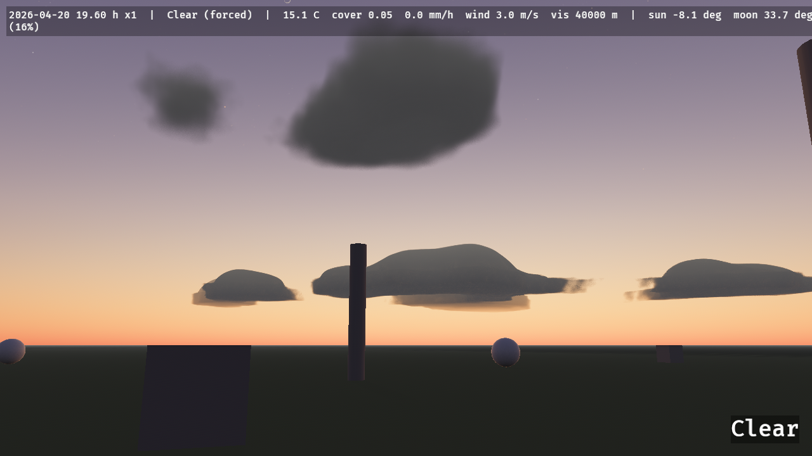 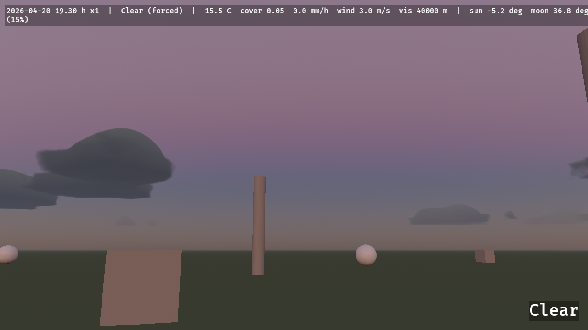

### Clock, sun, moon and stars

`WorldClock` holds the local date and hour and advances by `Time<Virtual>` × `time_scale`; `GeoLocation` places the observer. `SunState` has the sun's and moon's directions, true altitudes, the synodic phase and the lit fraction. The `astro` module exposes the ephemeris functions (Meeus ch. 7–48: sidereal time, nutation, the sun at 0.01°, the moon from a 51 + 34-term series, phase, refraction, the USNO total-illuminance factor), each tested against the book's worked examples and the SPA reference case. Stars are the 8404 Yale Bright Star Catalogue stars to V = 6.5, precessed to the date, coloured from B−V; the moon is a Lommel–Seeliger-shaded disc from NASA's LROC map. See [`src/celestial/PROVENANCE.md`](src/celestial/PROVENANCE.md).

### Climate, seasons and weather

`Climate` (`temperate`, `alpine`, `desert`, `tropical`, `tundra`) drives an hourly Markov scheduler over ten `WeatherPreset`s, seeded and frozen by a golden test, with temperature from annual and diurnal harmonics and a −6.5 °C/km lapse rate. `Weather` is the blended state every domain reads (cover, precipitation, temperature, humidity, wind, gustiness, visibility, storminess, dust). `WeatherDirector::force(preset, transition)` overrides it and `release(transition)` hands it back to the scheduler, which kept stepping meanwhile. `SeasonState` carries meteorological seasons and 0–1 autumn, leaf-fall and blossom curves; `SurfaceWeathering` the wetness, snow cover and snow depth of exposed ground. Messages: `WeatherChanged`, `SeasonChanged`.

### Wind

`WindState` has the prevailing wind, the 10 m speed, the gust factor, the wind at the camera and the simulated field: a `rgba16float` 3D texture, toroidally addressed, around the camera (64 × 16 × 64 cells of 4 m at High). Shaders sample it with the supported WGSL import:

```wgsl
import bevy_elements::wind::{WindFieldParams, elements_wind};
let v = elements_wind(wind_field, wind_sampler, wind_params, world_position);
```

bound to `WindState::field` and `WindState::field_params()`. `WindGust` is written when a gust band starts. `bevy_elements::noise` (gradient noise with analytic derivatives, fBm, Worley, curl) and `bevy_elements::grid` (bilinear taps into the crate's 2D grids) are also supported imports.

### Terrain

`Terrain` is a component: `Terrain::procedural(ProceduralTerrain::hills(seed))` (also `mountains`, `dunes`, `plains`, or your own relief, feature size, octaves and ridged mix), `Terrain::from_heightmap(image, height_range_m)` (a linearly read `R16Uint`, 16-bit normalised, float or 8-bit image) or `Terrain::flat(height)`, with `with_extent`, `with_resolution` and `external()`. It is centred on its `Transform` (default 2048 m, 1024² cells at High; the resolution is clamped to `ElementsQuality::terrain_max_resolution()` and to a power of two). One terrain exists at a time. The GPU generates `bedrock` and `sediment`, and keeps the layers hydrology and erosion write (`TerrainState`); `terrain_pack` rewrites a packed `terrain_cells` buffer that the materials, the wind solid mask and the precipitation kernel read, and the surface heights are copied back for `Environment::terrain_height(Vec2)`.

By default the crate draws the ground: a pool of 33 × 33-vertex patches selected by distance (CDLOD, Strugar 2009: one shared mesh, vertices morph onto the next coarser grid, no cracks, one draw per pass) with `TerrainMaterial`, which blends rock (slope above 40°), sand (sediment above 0.5 m), soil and grass from the slope and sediment per pixel, adds noise detail, and takes the cloud shadow map like the weathered materials do. With `Terrain::external()` you draw the ground yourself and give your mesh `ExtendedMaterial<StandardMaterial, GroundExtension>` (`GroundExtension::default()`): it adds cloud shadows by world position and darkens where water stands. Wind blows around the terrain and rain stops on it; with the `flora` feature `ElementsFloraPlugin` hands the height snapshot to `bevy_flora`. See [`docs/research/terrain.md`](docs/research/terrain.md).

### Fog

`DistanceFog` follows `Weather::visibility_m` (Koschmieder, 2 % contrast, grey extinction) with a colour lit like the scene; a 240 × 120 × 240 m ground-fog `FogVolume` around the camera thickens toward the ground and drifts with the wind. Bevy lights a `FogVolume` from the `DirectionalLight`s alone, which under cloud carry only the beam, so the volume fades out of the frame as the cloud thickens (its density is scaled by the beam's share of the scene's light and its intensity by the reciprocal): a blizzard is a whiteout from the sky and the distance fog, not a dark hole (measured: the noon zenith of a 200 m-visibility blizzard read `(46, 47, 50)` before and `(122, 124, 129)` after; `docs/research/fog.md` Deviation 7). `sky_air_extinction(σ_fog)` gives the excess of a fog extinction over clear air (`CLEAR_AIR_EXTINCTION`, the `Clear` preset's 40 km), which the cloud composite uses to fog the sky to the same colour as the ground (see Volumetric clouds).

### Clouds

`CloudPlugin` ray-marches a spherical cloud shell in compute at a quarter or half of the screen resolution and accumulates it into a full-resolution history over 4 or 16 frames. Coverage, type and precipitation come from a 512² weather map over 32 km that follows `Weather` (`CloudWeatherMap`): it is thresholded so the covered fraction of the sky equals `Weather::cloud_cover`, it is stratus, cumulus or cumulonimbus by the weather (`CloudLayer` holds the base and top heights), and it drifts with the wind. Light is energy-conserving single scattering with a two-lobe phase function and an approximation of multiple scattering, coloured by the sun's transmittance through Bevy's atmosphere and lit from inside by `LightningFlash`. The diffuse light that fills the shaded sides takes the colour of Bevy's own sky (the camera's atmosphere environment map over the upper hemisphere) mixed with the sunlight the cloud has scattered, so thick decks stay neutral by day while clouds after sunset turn violet in the purple light. A 1024² transmittance map over 8 km (`CloudShadows`) shades the ground and sets how much of the sun reaches the camera. Sky pixels carry the weather's air as well: the composite fogs them by `σ_air = σ_fog − 3.912/40 km`, taken from the camera's own `DistanceFog` with the clear-air floor removed (`fog::sky_air_extinction`), so the sky and the fogged ground converge on the same colour and a 200 m-visibility blizzard has no horizon line, while `Clear` is untouched (bit-exact). `CloudQuality::of(ElementsQuality)` gives the resolution, step counts and accumulation window.

### Lightning

Strikes are a Poisson process at `Weather::storminess / 60` per second of `Time<Virtual>`, uniform over an 8 km disc around the followed camera and deterministic from `Climate::seed`. Each one writes `LightningStrike { position, seed }`, spawns a bolt (a channel with side branches, then 1–3 restrikes 40–80 ms apart), lights the ground with a 1e8 lm `PointLight`, writes `LightningFlash` for the clouds, and writes `Thunder { position, distance_m, loudness }` `distance_m / 343` s of real time later. `StrikeLightning { at }` scripts a strike. The bolt's brightness is multiplied by the camera's exposure and clamped, so it saturates at night and fades by day. The strike process and messages run without a renderer.

### Precipitation

Rain and snow follow `Weather::precipitation_mm_h` and `snow_fraction()`. A buffer of `ElementsQuality::precipitation_particles()` particles (20 k / 60 k / 150 k / 300 k) fills a 60 m cube around the camera: rain takes `min(1, R/20)` of it and snow `min(1, S/3)` (both scaled down together when they would exceed it). Each raindrop has its own diameter, drawn from the water-weighted Marshall–Palmer distribution, and falls at its own Atlas–Ulbrich speed (4.98 m/s on average at 10 mm/h, 9 m/s at most); flakes fall at 1 m/s with a sideways flutter. Both ride the wind field, wrap around the camera, and are respawned at the top when they hit the ground or a `PrecipitationBlocker`; rain near the camera leaves splash rings. The draw pass (`Core3dSystems::EarlyPostProcess`) renders streaks, flakes and rings as procedural quads, lit by the sun, moon and sky light and soft-faded against the depth prepass.

```rust
# use bevy::prelude::*;
# use bevy_elements::*;
fn build_a_shelter(mut commands: Commands) {
    // No rain or snow falls inside this 6 × 0.2 × 6 m roof, and its top collects the splashes.
    commands.spawn((
        PrecipitationBlocker { half_extents: Vec3::new(3.0, 0.1, 3.0) },
        Transform::from_xyz(8.0, 3.0, 4.0),
    ));
}
```

The nearest 256 blockers to the camera are tested; any oriented box works (`GlobalTransform` rotation and scale apply). The far field is the fog volume's: `FogPlugin` splits the visibility's extinction `3.912 / visibility` into the precipitation's own (rain `2.12×10⁻⁴ R^0.68` m⁻¹, snow `4.917×10⁻³ S` m⁻¹, from measured visibility–rate relations) rendered as wind-slanted shafts, and the remaining haze, so `Weather::visibility_m` stays the single authority on how far you see. The particles need `WindPlugin` and an `ElementsCamera`; `PrecipitationState` exposes the GPU buffers. Rain lands on the terrain's surface plus the water standing on it, or on the plane y = 0 without a terrain.

### Weathered materials

`WeatheredMaterial` is `ExtendedMaterial<StandardMaterial, WeatheredExtension>`: give any mesh one and it follows the weather. `WeatheredPlugin` writes `ElementsGlobals` every frame (wetness and snow cover from `SurfaceWeathering`, the rain intensity `min(1, R_liquid/20)`, the cloud shadow map, ripple and streak phases) into one 80-byte storage buffer all weathered materials bind (binding 101, fragment stage only: it leaves the fragment stage two of the eight storage buffers WebGPU guarantees). A wet surface loses up to half its albedo in proportion to its porosity (Lagarde's gloss-based estimate: rough surfaces soak, plastic, tile and metal do not) and its roughness falls toward 0.1; rain on a wall adds darker streaks that run down it; faces turn white under snow with the curve `snow · smoothstep(0.85 − 0.6 snow, +0.2, n.y)` that `bevy_flora` uses, snow albedo `SNOW_ALBEDO` and roughness `SNOW_ROUGHNESS`, so trees and buildings read as one snow. `WeatheredExtension::exposure` is 1 under open sky and 0 sheltered (no wetness, streaks or snow, only cloud shadow): it does not follow a `PrecipitationBlocker` by itself, set it from your own test.

```rust
# use bevy::prelude::*;
# use bevy_elements::*;
fn spawn(mut commands: Commands, mut meshes: ResMut<Assets<Mesh>>, mut materials: ResMut<Assets<WeatheredMaterial>>) {
    let house = materials.add(WeatheredMaterial {
        base: StandardMaterial { base_color: Color::srgb(0.55, 0.26, 0.2), perceptual_roughness: 0.9, ..default() },
        extension: WeatheredExtension::default(),
    });
    commands.spawn((Mesh3d(meshes.add(Cuboid::new(9.0, 5.0, 7.0))), MeshMaterial3d(house)));
}
```

The shading is a public WESL import for your own shaders, `bevy_elements::surface_cover` (`weather_surface`, `mesh_snow_cover`, `rain_streak`, `ripple_offset`, `ElementsGlobals`): bind `ElementsGlobals`'s buffer at any slot. The forward and deferred passes are covered; the depth and normal prepass stays Bevy's, so SSAO reads the dry normal. Order-independent transparency, meshlets and forward decals are not weathered.

### Hydrology and erosion

`HydrologyPlugin` simulates water on the `Terrain`'s grid with Mei et al.'s virtual pipes, the pipe's cross-section taken from the local depth (so waves travel at 0.9 √(g d), not at a constant speed) and Manning friction (`HydrologySettings::manning_n`, 0.035). Time runs in fixed 20 ms substeps scheduled from *real* time (`HydrologySettings::time_scale`, independent of the `WorldClock`), at most `ElementsQuality::hydrology_substeps()` a frame (2 / 4 / 4 / 16), on a grid of at most `terrain_max_resolution()` cells per side (256 / 512 / 512 / 2048). The boundary is an open free overfall or a closed wall. Rain is the weather's, split into rain and snow per cell at that cell's lapse-rate temperature, delivered in quanta of at least 5 µm so it is never lost to f32 rounding, and shaded by `PrecipitationBlocker`s. `WaterSource` and `WaterSink` pour or drain a rate over the cells within a radius.

```rust
# use bevy::prelude::*;
# use bevy_elements::*;
fn pour_a_river(mut commands: Commands, mut bake: MessageWriter<ErodeTerrain>) {
    // 50 m³/s over the cells within 5 m of this point; the weather's rain falls everywhere.
    commands.spawn((
        WaterSource { rate_m3_s: 50.0, radius_m: 5.0 },
        Transform::from_xyz(-200.0, 4.0, 0.0),
    ));
    // Ten simulated minutes of erosion under 20 mm/h, at the quality's full substep rate.
    // `TerrainBaked` follows when it is done.
    bake.write(ErodeTerrain { duration_s: 600.0, rain_mm_h: 20.0 });
}
```

`ErosionSettings` carries Mei's capacity law `K_c · max(sin α, min_tilt) · |v|`, dissolve and deposit (sediment first, then bedrock; sediment moves with the water through the same pipe fluxes, so solids are conserved to rounding) and thermal erosion every 4th substep (35° talus, bedrock above 45°). **Bare bedrock erodes at the capacity rate**: the `flood` valley's 50 m³/s river carves its bedrock by up to 7.9 m in 120 s of simulated time and arrives at a marker 100 m away after 63 s instead of 36 s, so set `ErosionSettings::enabled = false` for a flood that should not change the ground (the `flood` example does). `HydrologyStats` counts substeps and simulated time, for code that waits on them.

### Water

`WaterPlugin` (part of `ElementsPlugins`) draws the water the hydrology simulates; `WaterSettings` (insert it first to override) holds the look. A patch of the terrain's level-of-detail selection that has at least 3 mm of water somewhere in it is drawn twice, by two entities with one `WaterExtension` and two `WaterMaterial`s: the **absorb** pass multiplies what is under the water by `(1 − F) · exp(−σ t)` per colour channel (σ = `absorption`, default `(0.45, 0.06, 0.03)` m⁻¹: red goes first, so a metre of water turns the bed blue-green, which one blend cannot do), where `t` is the thickness from the depth prepass corrected for the refracted ray; the **surface** pass adds the Fresnel reflection of the sky (`F₀ = 0.02`) and sun, the body colour of silt, and foam where the flow is fast or the water is thin, the ripples flow-mapped from the simulated velocity (Vlachos 2010, two phases).

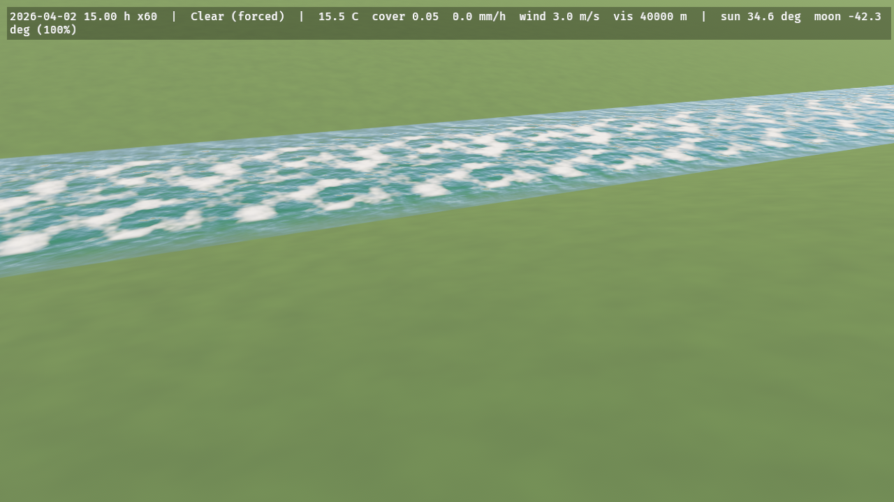 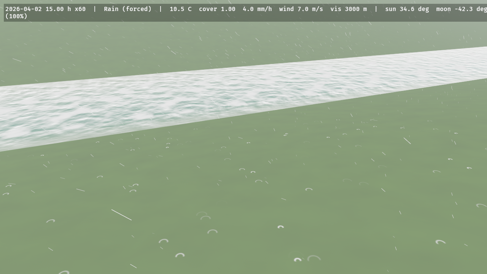

### Ground cover

`GroundCoverPlugin` keeps two maps on the `Terrain`'s grid, stepped on game time (the `WorldClock`) at most 20 times a second after hydrology's substeps. **Snow** is a depth and a water equivalent per cell: it accumulates at the cell's own rain–snow split (the lapse rate makes ridges snowier than valleys), keeps less on slopes between 35° and 55° and none under a `PrecipitationBlocker` (the roof's shelter follows the slanted fall of the rain or snow), settles from 100 toward 300 kg/m³ with a 3-day time constant, drifts downwind above 5 m/s (a flux that grows with the cube of the excess, deposited where the wind slows in the lee), is smoothed over a few cells, and melts at 4 mm of water per °C per day, every millimetre arriving in the `water` layer. **Wetness** follows rain and evaporation; the terrain and ground materials shade snow, wet darkening and gloss, and puddles with ripples.

```rust
# use bevy::prelude::*;
# use bevy_elements::*;
fn deep_wet_snow(mut commands: Commands) {
    commands.insert_resource(SnowSettings {
        degree_day_factor: 6.0,
        shed_slope_deg: [30.0, 45.0],
        ..default()
    });
    commands.insert_resource(WetnessSettings {
        puddle_min_m: 0.004,
        ..default()
    });
}
```

`Environment::snow_depth(Vec2)` and `wetness(Vec2)` answer from the last readback like `water_depth`. `SurfaceWeathering` (and so `ElementsGlobals` and `WeatheredMaterial`) follows the mean of the maps within 50 m of the camera once a terrain has been read back; before that, and without a terrain, it is the point model at the reference elevation.

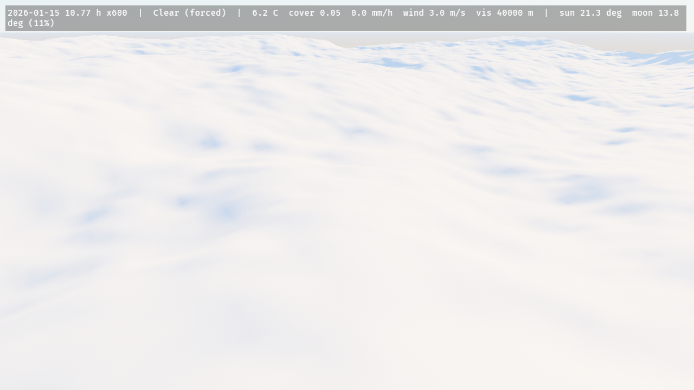 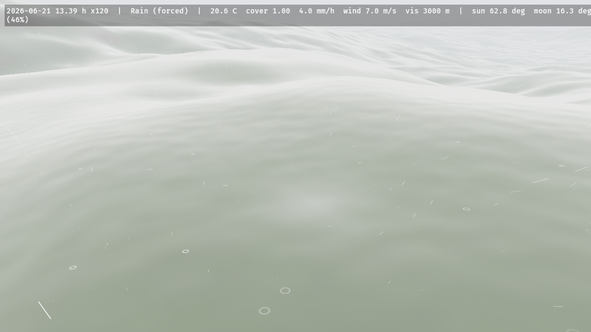

### Dust storms

`DustPlugin` moves the terrain's loose sand with the wind. Where the surface wind (the weather's 10 m wind, sped up over crests by Paris et al.'s Venturi term and sheltered behind rises by their 15° shadow rule) exceeds 8 m/s, the sand flux relaxes toward `q = k u² (u − u_t)` over a 10 m saturation length, and the bed changes by the flux's divergence, so sand is conserved exactly and cannot go negative; hydrology's thermal kernels then avalanche it at 34°. It runs at most 20 times a second, only while the wind can exceed the threshold, and advances the bed by the virtual time × `WorldClock::time_scale` (the plan's coefficient is 167× the physical flux, so the sand evolves in game time, `DustSettings` and `docs/research/dust.md` Deviation 1). A forced `WeatherPreset::DustStorm` also fills 40 % of the precipitation particle buffer with tan sprites and tints the ground fog.

```rust
# use bevy::prelude::*;
# use bevy_elements::*;
fn a_dust_storm(mut commands: Commands, mut director: ResMut<WeatherDirector>) {
    commands.spawn(Terrain::procedural(ProceduralTerrain::dunes(7)));
    director.force(WeatherPreset::DustStorm, std::time::Duration::ZERO);
}
```

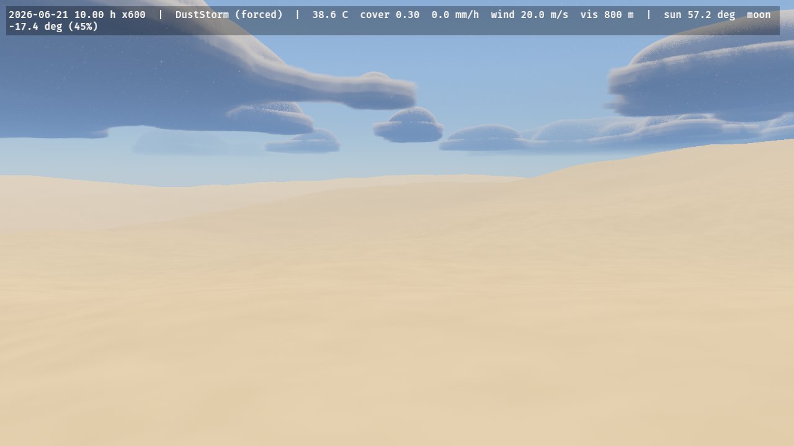

The stripped upwind edge of the sand sheet, 10 s and 70 s into the `dust_storm` example (`ELEMENTS_FRAMES=600` and `4200`): the bare ground band is the sand the wind has carried downwind.

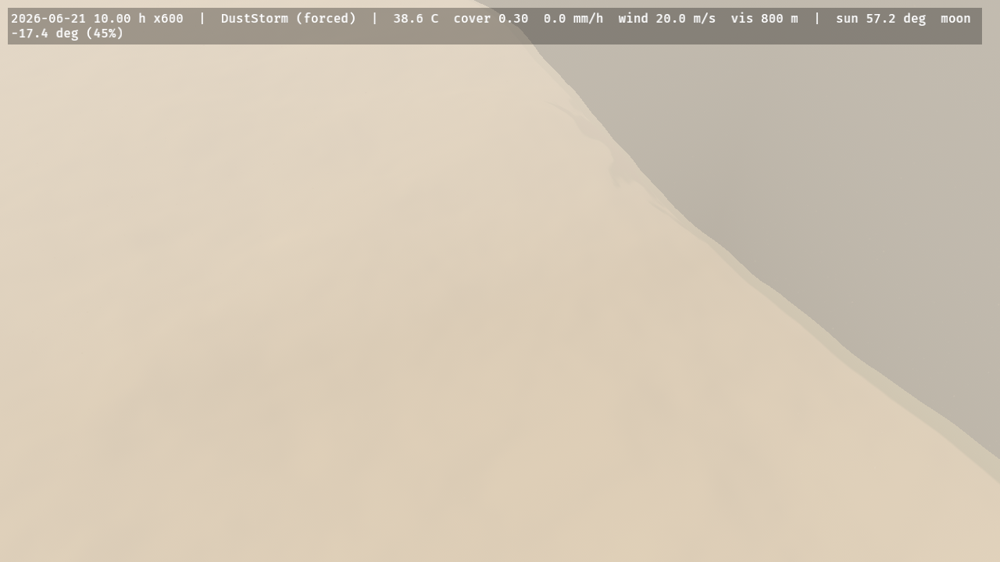 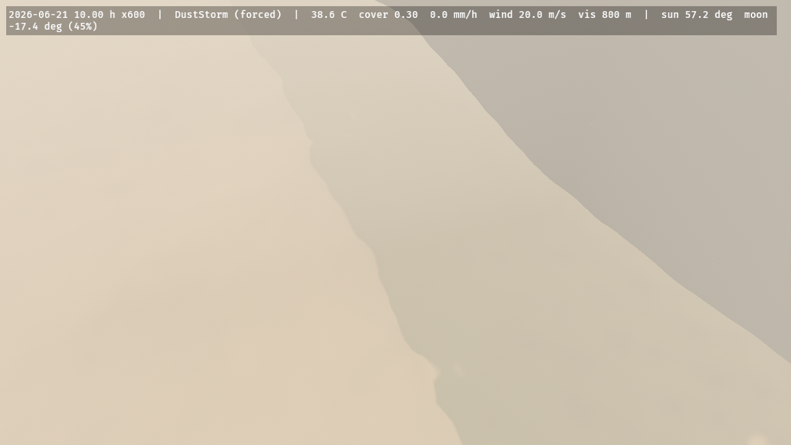

### Trails

`TrailsPlugin` presses footprints, ruts and tracks into the ground. Put an `Imprint { half_extents, load_n }` on anything that touches the ground (a foot, a hoof, a wheel, a body lying down): while its translation (the sole) is within 0.1 m of the undisturbed surface it sinks as deep as the ground gives under its load (Bekker–Wong pressure–sinkage with Wong's constants; in snow no deeper than the snow compacts to 500 kg/m³, CRREL 90-9; never deeper than a 0.30 m loose layer), and pushes up a rim of what it displaced but could not compress (a tenth of the volume in snow, all of it in dry sand). A 77.5 kg walker on a 10 × 26 cm sole leaves 24 cm in 30 cm of fresh powder, 3.4 cm in dry sand, half a centimetre in dry soil and the full 30 cm in mud. Between frames an imprint carves the whole path it swept, so a fast wheel leaves an unbroken rut. The weather takes the trails back: new snow fills a trench by exactly what the cover map gained, melt and settling clamp it to the snow, the snow drift and the sand flux smooth it as diffusion, and dry sand slumps to 34°, wet sand to 10° and mud to 63°.

The field is a camera-following window of centimetre texels (Low 512² × 8 cm, Medium 1024² × 6 cm, High 1024² × 5 cm, Ultra 2048² × 3 cm) simulated in four compute kernels and drawn per pixel, never as geometry, by the terrain material and `GroundExtension`: parallax occlusion mapping with one sample per texel and a bisection on a cubic B-spline of the field, the lighting at the visible point, a soft self-shadow toward the sun or moon and an occlusion term on the trench floor. Compacted snow on a print's floor is smoother and bluer, a print through thin snow shows the ground, a trench through grass shows the soil, and the floors of ruts in saturated ground hold water. `TrailState` publishes the field for a ground shader of your own (`bevy_elements::trails::surface`).

```rust
# use bevy::prelude::*;
# use bevy_elements::*;
fn a_boot(mut commands: Commands) {
    // A sole of 10 × 26 cm under a 77.5 kg walker on one foot; move it with the animation and
    // lift it more than 0.1 m off the ground to stop pressing.
    commands.spawn((Imprint::new(Vec2::new(0.05, 0.13), 760.0), Transform::default()));
}
```


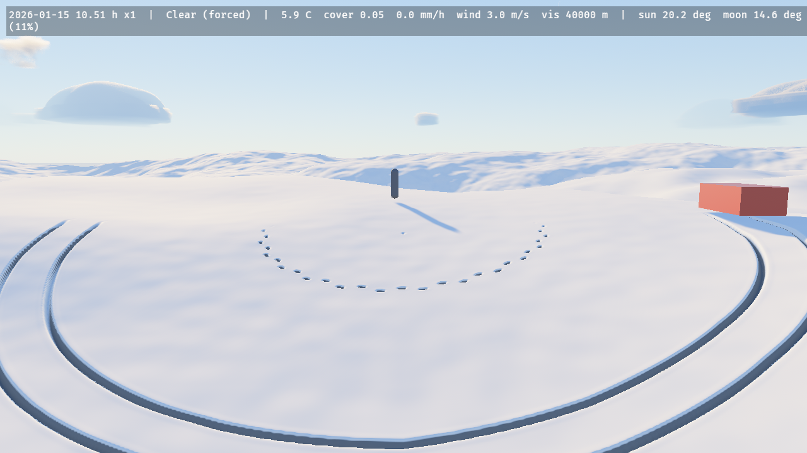

Dry sand at evening (the prints slump to rounded dishes with a raised rim) and mud after rain (the ruts show the soil through the grass):

 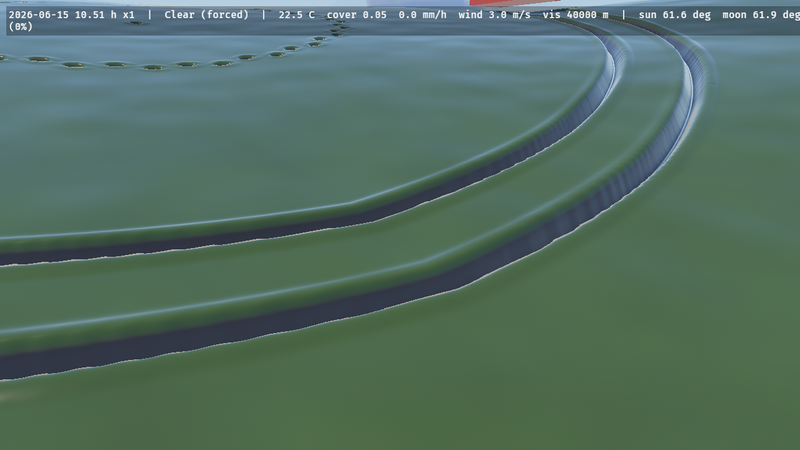

### Waves

`WavesPlugin` makes the hydrology's water answer what moves through it. Put a `WaterContact { half_extents }` (an ellipsoid along the entity's local axes, any rotation) on a hull, a float, a wader's legs or a falling stone: where it cuts the surface it presses down with the pressure head of its occupied column (its draft for a shallow hull, less for a deep narrow leg whose lower part the waves do not reach), plus Bernoulli's impact head `v²/2g` while it crosses the surface going down. At rest the water stays flat around it; moving, it leaves a wake bounded by Kelvin's 19.47°; bobbing or dropped in, it sends out rings in which the short waves outrun the long ones. Waves reflect off the shores, slow in the shallows, are carried by the current, break where they grow steeper than water holds (amplitude 7 % of the wavelength) and leave foam that fades over a few seconds.

The field is three camera-following windows a factor of four apart (High: 512² of 5, 20 and 80 cm, out to 410 m), each a linear capillary-gravity wave field stepped by Tessendorf's iWave scheme with a 13 × 13 kernel fitted at start-up to Airy's dispersion over its band (within 1.5 %), forced by the bodies' head split into the bands like a Laplacian pyramid. The water's surface and absorb passes add its slopes to the flow-mapped ripples and draw its breaking foam; `WaveState` publishes it for a water shader of your own. `WaveSettings::damping_per_s` sets how long a wake lasts.

```rust
# use bevy::prelude::*;
# use bevy_elements::*;
fn a_float(mut commands: Commands) {
    // A 25 cm ball; move its transform and the water answers.
    commands.spawn((WaterContact::sphere(0.25), Transform::from_xyz(0.0, 5.7, 0.0)));
}
```


 

### Snow on voxel volumes

With the feature `isomesh` (`bevy_elements = { version = "0.5", features = ["isomesh"] }`, `bevy_isomesh` and `isomesh` 0.0.11), `ElementsPlugins` also adds `VoxelPlugin`. The snow maps are heightfields, so a `VoxelVolume` gets one of its own: put `VoxelGround { resolution }` on the volume's entity and the crate scans the top of every column (the first sign change from the top, then bisection to a millimetre), spawns the crate's `Terrain` (`TerrainRender::External`) over the volume's XZ extent with those heights, and wraps the volume's field in a `SnowyField`. Hydrology, snow, wetness, wind and rain then run on it unchanged.

`SnowyField` is `min(base(p), max(p.y − (top + snow), (top − c) − p.y))`: the union of your field with a slab from one voxel `c` below the column top to the snow surface, so the mesh grows a cap while everything at least a voxel under the top, a tunnel under the hill, keeps the sign of your field exactly and never gets snow. The snow depth is the last cover readback, held per column: a column's depth is swapped only when it has moved more than half a voxel from the one the mesh was made from, the new field is installed with `replace_field`, and only the chunks the changed columns can reach are marked `NeedsRemesh`, so the seams between chunks stay closed. Edits to the volume are seen: order the system that calls `replace_field` and marks the chunks `.before(VoxelGroundSystems)`, and the tops under the marked chunks are rescanned and written to the terrain before the chunks are meshed, in the same frame.

```rust,no_run
# use bevy::prelude::*;
# #[cfg(feature = "isomesh")]
# mod voxel {
# use bevy::prelude::*;
# use bevy_elements::*;
# use bevy_isomesh::{NeedsRemesh, VoxelChunk, VoxelVolume};
# use isomesh::chunk::{ChunkId, ChunkLayout};
fn setup(mut commands: Commands, mut grounds: ResMut<Assets<GroundMaterial>>) {
    // 64 m of 0.5 m voxels: one terrain cell is one voxel wide.
    let Ok(layout) = ChunkLayout::new(16, 0.5, [-32.0, -8.0, -32.0]) else {
        return;
    };
    let volume = commands
        .spawn((
            VoxelVolume::new(layout, isomesh::fields::Sphere { center: [0.0; 3], radius: 6.0 }),
            VoxelGround::new(UVec2::splat(128)),
        ))
        .id();
    commands.spawn((VoxelChunk { id: ChunkId::new([4, 1, 4]), volume }, NeedsRemesh));
    // The material of the volume's chunk meshes stops snow and wetness a voxel under the column top.
    let _ground = grounds.add(GroundMaterial {
        base: StandardMaterial::default(),
        extension: GroundExtension::default().with_column_gate_m(0.5),
    });
}
# }
# fn main() {}
```

`ErosionSettings::enabled` is ignored for voxel ground (one warning is logged when it is on): erosion would rewrite only the heightfield under the volume, whose field is the truth. Water still flows, snow melts into it, and `ErodeTerrain` bakes run without erosion. `VoxelGround` owns the crate's single terrain, so spawn no other `Terrain` and no second `VoxelGround`; the grid is frozen to the chunk entities present at the first scan, the voxel size must be a power of two (isomesh's seam rule), and the chunk entities need identity transforms. The ground material of the chunk meshes needs `GroundExtension::with_column_gate_m(c)`, or the walls of a tunnel are shaded white wherever the map above them has snow. Limits (`docs/research/voxel-snow.md`): the maps are heightfields, so a ledge below the highest crossing gets no snow and the floor of a shaft open to the sky does; a roof thinner than a voxel is thickened to one under the slab; a carve leaves the snow depth that was on the carved surface until the snow's own dynamics sort it out; wasm meshes on the main thread, so keep `MeshBudget::max_in_flight` low there.


`voxel_snow` after 25 game hours of forced snow, the sky cleared: a cap of snow over the hill and over the mouths of the two tunnels, and none inside them.

## Gameplay queries

```rust
use bevy::prelude::*;
use bevy_elements::*;

fn seek_shelter(env: Environment) {
    let weather = env.weather();
    if weather.precipitation_mm_h > 2.0 || (!env.is_daylight() && env.temperature_c() < 0.0) {
        // ...
    }
    let gust_at_head = env.wind_at(Vec3::new(10.0, 1.8, -4.0));
    let _ = (gust_at_head, env.snapshot_age());
}
```

`wind_at` answers from the GPU field as of the last readback (4 Hz by default, `ElementsReadback`) and falls back to the prevailing wind outside it or before the first readback; `snapshot_age` says how old the answer is. The queries work in an app with no window (a headless server rendering only to an image): there each frame waits for its own GPU work, since nothing presents to pace it, so a readback still lands one frame after it is requested.

`water_depth(Vec2)` is the water above the ground at a world XZ: `None` until the first readback or off the terrain, `Some(0.0)` on dry ground. `water_velocity(Vec2)` is the depth-weighted flow velocity (half resolution). Both are bilinear samples of the last readback.

`snow_depth(Vec2)` is the snow on the ground in metres and `wetness(Vec2)` how wet it is (0 dry, 1 a full 2 mm film); like the water queries they are `None` before the first readback or off the terrain.

`cloud_shadow_at(Vec3)` is the direct transmittance of the clouds toward the sun (the moon at night) at a world position, 0 in a thick cloud's shadow to 1 in the open, from the cloud shadow map sampled every 31.25 m over 8 km around the camera (1 outside it); `illuminance_at(Vec3)` is the horizontal illuminance there in lux, the clear-sky sun and moon light times `0.25 + 0.75 · T`. Only the clouds shadow them, not terrain or meshes. `cloud_shadow_at` is `None` before the first readback; `illuminance_at` then uses the cover-only estimate.

**Saving the weather.** The weather's save state is `WorldClock`, `Climate`, `GeoLocation` and `WeatherDirector` (the scheduler's chain position, a forced preset and the blend in progress); `Weather` is recomputed from them each frame. With the `serde` feature all four serialize; insert the saved copies before the next `ElementsSystems::Weather` run and the weather continues exactly as saved, where a fresh director would restart the chain at `Clear`. The GPU layers (snow cover, wetness, water, terrain) are not part of it. `tests/save.rs` shows the round trip.

## Plays well with

- **`bevy_flora`** (feature `flora`): add `ElementsFloraPlugin` next to `FloraPlugin`. It writes `FloraWind` (direction, strength = 10 m speed / 20 m/s, turbulence, gust strength, and every `WindGust` as a `GustFront`), `FloraSeason` (autumn, leaf fall, blossom, snow = `SurfaceWeathering::snow_cover`) and `FloraWetness`. Trees and their sway stay `bevy_flora`'s.
- **`isomesh` / `bevy_isomesh`** (feature `isomesh`): add `IsomeshPlugin` next to `ElementsPlugins` and put `VoxelGround` on a `VoxelVolume` for snow on voxel ground (above). Meshing, chunks and the volume stay `bevy_isomesh`'s.
- **`bevy_carnage`, `bevy_light_grid`** (Bevy 0.19): no dependency either way. Glue in the game copies plain data across, e.g. `SurfaceWeathering::wetness` into a blood-drying rate, or `Environment::sun()` into a light grid's sky term.

## Performance

GPU time per frame on an RTX 3090 (Vulkan), the minimum over Bevy's diagnostic history so it is the full-clock cost (`examples/bench_elements.rs`; a lightly loaded GPU idles at 210–450 MHz and reads 5–10× slower).

| Quality | Wind grid | Jacobi iterations | Wind | Ground-fog density | Total |
|---|---|---|---|---|---|
| Low | 32 × 8 × 32 | 10 | 0.087 ms | 0.037 ms | 0.124 ms |
| Medium | 48 × 12 × 48 | 10 | 0.119 ms | 0.037 ms | 0.156 ms |
| High | 64 × 16 × 64 | 12 | 0.233 ms | 0.037 ms | 0.270 ms |
| Ultra | 96 × 24 × 96 | 40 | 1.704 ms | 0.037 ms | 1.741 ms |

The budget for wind + fog at High is 0.3 ms. Ultra keeps 40 Jacobi iterations and the plan's grid; it is for large budgets. The fog column predates precipitation: with the shaft term (a second two-octave fBm and a weather-map sample per texel) the density kernel reads 0.058 ms at High (the kernel does not depend on the quality; measured at High only).

Precipitation at High (150 000 particles), 3840 × 2160, the worst case of 25 mm/h (every rain particle active) with 14 m/s wind, minimum over the diagnostic history with the GPU at 1800 MHz:

| Blockers | `elements_precip_sim` | `elements_precip_draw` | Fog kernel increase | Total |
|---|---|---|---|---|
| none | 0.028 ms | 0.126 ms | 0.021 ms | 0.175 ms |
| 256 (the most uploaded) | 0.227 ms | 0.126 ms | 0.021 ms | 0.374 ms |

The budget is 0.4 ms. The simulation tests every uploaded blocker for every particle, so its cost is the blocker count times the particle count.

Clouds at 1920 × 1080, PartlyCloudy (the scene the clouds note fixes for the bench), minimum over the diagnostic history with the GPU at 1800 MHz; the 128³ + 32³ noise volumes are generated once at startup (0.201 ms):

| Quality | March resolution | Primary steps | Weather map | Shadow map | March | Resolve | Composite | Total |
|---|---|---|---|---|---|---|---|---|
| Low | 1/4 | 32 | 0.085 ms | 0.081 ms | 0.040 ms | 0.067 ms | 0.035 ms | 0.307 ms |
| Medium | 1/4 | 48 | 0.086 ms | 0.066 ms | 0.041 ms | 0.067 ms | 0.034 ms | 0.293 ms |
| High | 1/2 | 64 | 0.085 ms | 0.069 ms | 0.095 ms | 0.068 ms | 0.035 ms | 0.351 ms |
| Ultra | 1/2 | 96 | 0.085 ms | 0.067 ms | 0.125 ms | 0.068 ms | 0.034 ms | 0.378 ms |

The budget is 1.0 ms at High. The weather map, shadow map, resolve and composite passes cost about 0.27 ms at every quality, so the qualities differ only in the march, and Low and Medium (both a quarter of the resolution) within the measurement's noise.

Terrain with 1024² cells over 2048 m (`hills(42)`; measured before High took Medium's 512² simulation size, below), 3840 × 2160, the camera 30 m above the ground looking 20° above the horizon (about half the frame is ground), minimum over the diagnostic history with the GPU at 1800–1950 MHz: the generator and first pack (`elements_terrain`: generate, pack, flow pack, leaf bounds and readback kernels, once at spawn, then again only when hydrology or erosion changes a layer) 0.34 ms; the terrain drawn: Bevy's `main_opaque_pass_3d` 0.088 ms (mean 0.146) against 0.016 ms (0.025) for the flat test scene, and the depth prepass 0.005 ms (0.002 ms for the flat scene). The selection picks at most 133 patches at High over 1500 random cameras, and the pool update writes nothing for a patch that kept its slot and bounds.

Hydrology and erosion (`elements_hydrology`: every substep's two kernels, the thermal kernels on every 4th, and the readback kernels on a readback tick), minimum over the diagnostic history after 240 warm-up frames, a 2 km procedural terrain with a 50 m³/s `WaterSource`, the quality's full substeps per frame; the GPU held 1800–1950 MHz (P2) with the clocks logged in the same shell:

| Quality | Grid | Substeps per frame | `elements_hydrology` | Terrain pack passes (`elements_terrain`) |
|---|---|---|---|---|
| Low | 256² | 2 | 0.033 ms | 0.022 ms |
| Medium | 512² | 4 | 0.255 ms | 0.042 ms |
| High | 512² | 4 | 0.258 ms | 0.043 ms |
| Ultra | 2048² | 16 | 14.75 ms | 0.478 ms |

The plan's budget for hydrology and erosion at High is 0.6 ms for 1024² at 8 substeps, which measures **1.86 ms** (0.23 ms per substep, 80 % of the card's memory bandwidth, as `docs/research/hydrology.md` predicted), so High takes Medium's values (512², 4 substeps; `ElementsQuality::terrain_max_resolution` and `hydrology_substeps`) and Ultra keeps the research resolution and 16 substeps (14.75 ms; it is for large budgets). A 600 s bake at High is 7500 frames: 125 s at 60 fps.

Water (`WaterPlugin`), `ELEMENTS_TERRAIN=lake ELEMENTS_QUALITY=ultra` (a 256 m plain with a 100 m round basin filled by a 200 m³/s source, the camera 45 m up so the lake covers about a third of the frame), minimum over the diagnostic history after the lake is full, the GPU in P2 at 1800–1950 MHz with the clocks logged in the same shell: Bevy's `main_transparent_pass_3d`, which holds both water passes, costs **0.394 ms** at 1920 × 1080 (mean 0.409; 0.002 ms with `ELEMENTS_WATER=off`) and 1.196 ms at 3840 × 2160; the plan has no water budget and the note's informational target (0.3 ms for a half-screen view at 1080p) is missed by about 1.3× at an estimated 43 % coverage (`docs/research/water-rendering.md`, Validation 14). The `water_normals` kernel runs once at spawn (10 dispatches, 512² down to 1 texel).
Ground cover (`elements_snow`: source, drift flux and apply and two diffusion passes per step; `elements_wetness`: the wetness update, the render pack and, on a readback tick, the readback kernel; both at most 20 times a second), a Blizzard so the drift runs, minimum over the diagnostic history, 3840 × 2160, the GPU at 1800–1950 MHz with the clocks logged in the same shell:

| Quality | Grid | `elements_snow` per step | `elements_wetness` per step | Per frame at the 20 Hz cap (60 fps) |
|---|---|---|---|---|
| High | 512² | 0.084 ms | 0.042 ms | 0.042 ms |
| Ultra | 2048² | 1.366 ms | 0.514 ms | 0.63 ms |

The per-frame target (≤ 0.3 ms at High) holds up to 1024² (0.47 ms a step, 0.16 ms a frame). `elements_shelter`, the mask that keeps snow and rain from the ground under `PrecipitationBlocker`s, runs only when the blockers or the wind change: 0.025 ms at 512² with no blocker, 1.67 ms at 2048². See [`snow-cover.md`](docs/research/snow-cover.md) and [`wetness.md`](docs/research/wetness.md) for the model and the validation numbers.
Aeolian transport (`elements_aeolian_*`, at 3840 × 2160 with the GPU at 1800–1950 MHz, minimum over the diagnostic history, `ELEMENTS_TERRAIN=dunes` in a forced `DustStorm`): at High's 512² grid one step costs **0.236 ms** (capacity 0.023, flux scan 0.113, bed move 0.013, two avalanche passes 0.087), 0.079 ms per 60 Hz frame at the 20 steps a second cap; at Ultra's 2048² 1.997 ms per step, 0.666 ms per frame. The plan has no budget for dust; the note's target was ≤ 0.3 ms per frame at 1024², which interpolates to about 0.19 ms.

Trails (`elements_trails`: stamp, merge, block occupancy and relax over the window, every frame; `bench_elements` with `ELEMENTS_TERRAIN=hills ELEMENTS_IMPRINTS=16`, 1920 × 1080, the GPU at 1500–1935 MHz, minimum over the diagnostic history): **0.119 ms** at High's 1024² × 5 cm window with 16 wheels pressing, against the note's 0.15 ms. The parallax in the terrain material skips any pixel whose ray meets no trail (the published block occupancy): `main_opaque_pass_3d` read 0.054–0.058 ms with `ELEMENTS_TRAILS=off` and 0.057–0.058 ms on. See [`trails.md`](docs/research/trails.md).

Waves (`elements_waves_force`: the bodies' head and the per-texel forcing, depth and current; `elements_waves_step`: one 1/60 s substep of all three cascades; `elements_waves_publish`: slopes and foam into the field; `bench_elements` with `ELEMENTS_TERRAIN=lake ELEMENTS_CONTACTS=8`, the camera over the filling lake, 1920 × 1080, the GPU at 1740–1800 MHz, minimum over the diagnostic history): High (3 × 512²) 0.037 + 0.217 + 0.033 = **0.29 ms** a frame with currents everywhere (each tile texel then fetched upstream, four loads), 0.23 ms on still water; Medium the same; Low (3 × 256²) 0.15 ms. Dry texels cost only their depth, so a window over land is nearly free. The water's shading of the field is within the run-to-run spread of `main_transparent_pass_3d`. This is above the note's 0.15 ms: a third cascade was the price of holding Airy's dispersion over 15 cm to 10 m waves (`waves.md` Deviation 1, 10).

Voxel snow is CPU work on the main world (the column-top scans and the chunk remesh), not a GPU pass, so it reports through the ignored `voxel_cost` release test rather than `bench_elements` (`docs/research/voxel-snow.md`): the initial scan of 16 384 columns (the `voxel_snow` example's 128 × 128) is 11.7 ms once at spawn; a user edit's column rescan 0.125 ms and one crest chunk's Marching Cubes 0.428 ms, both under the frame budget the note gives them (2 ms); the two depth-swap frames of a 60 game-hour run cost no more than the frame budget (2.9 ms of the 33 ms target); the median frame over 3 600 frames is 2.86 ms.

## Platforms

Native (Vulkan, Metal, DX12) and wasm WebGPU. WebGL2 is unsupported: the simulation needs compute. Simulation state lives in storage buffers and published fields in write-only `rgba16float` storage textures: the wind kernels share one layout of seven storage buffers and one storage texture, the fog kernel one storage texture, inside WebGPU's default limits of 8 and 4 per stage (devices limited to the `downlevel` 4 storage buffers are not supported; the hydrology substep kernels bind exactly 8). The cloud kernels bind at most one storage texture and two storage buffers each, the precipitation kernel four storage buffers; the precipitation draw reads its particles in the vertex stage, which needs `DownlevelFlags::VERTEX_STORAGE` (every Vulkan, Metal, DX12 and WebGPU device has it). GPU timestamps for the bench exist on Vulkan and DX12 only.

## What it deliberately does not do

- Trees, foliage, leaf colour and snow on branches: `bevy_flora` owns them.
- Isosurface and voxel meshing: `isomesh` owns it.
- Oceans and FFT waves.
- Bit-deterministic GPU simulation. Astronomy, the weather scheduler and lightning are deterministic and seeded; GPU results are not.
- A Purkinje shift or other low-light colour change: exposure keeps night dark, but colour handling is left to the tonemapper.

## Compatibility

| bevy_elements | bevy | notes |
|---|---|---|
| 0.1 – 0.5 | 0.20 | 0.5's `isomesh` feature needs `isomesh`/`bevy_isomesh` 0.0.11 |

## Research

- [Bevy 0.20 render APIs](docs/research/bevy-0.20-render.md) — the verified paths and signatures this crate builds on.
- [What the home-still corpus holds](docs/research/corpus.md) — the reading list per domain.
- [Celestial](docs/research/celestial.md) — Meeus, Reda & Andreas (SPA), Krisciunas & Schaefer, Jensen et al., Ballesteros, USNO Circular 171, Larson et al. (tone reproduction).
- [Twilight and the night sky](docs/research/twilight.md) — Hulburt 1953, Haber et al. 2005, Hillaire 2020, Patry 2021: the sun lighting the sky below the horizon, the night glow behind the atmosphere, the glow-capped exposure.
- [Climate and weather](docs/research/climate-weather.md) — Richardson 1981, ISO 2533, Jennings et al. 2018.
- [Wind](docs/research/wind.md) — Stam 1999, Harris 2004, Bridson et al. 2007, Kim et al. 2008, WMO.
- [Lightning](docs/research/lightning.md) — Reed & Wyvill 1994, Kim & Lin 2004, Poelman et al. 2021, Rakov, Tatarchuk 2006.
- [Fog](docs/research/fog.md) — Wronski 2014, Hillaire 2015, Wenzel 2006, Real-Time Rendering.
- [Terrain](docs/research/terrain.md) — Strugar 2009 (CDLOD), Andersson 2007, Musgrave et al. 1989, Galin et al. 2019, Mei et al. 2007.
- [Precipitation](docs/research/precipitation.md) — Marshall–Palmer drops, Garg & Nayar, Langer et al., Wang & Wade, Kanazawa & Uchida, Rasmussen et al., Tatarchuk.
- [Clouds](docs/research/clouds.md) — Schneider 2015 and 2017 (Horizon Zero Dawn, Nubis), Hillaire 2016 and 2020, Högfeldt 2016, Patry 2021, Real-Time Rendering, Kasten & Czeplak 1980.
- [Wetness, puddles and weathered materials](docs/research/wetness.md) — Lagarde 2013 (wet surfaces, rain), Jensen et al. 1999, Tatarchuk 2006, FAO-56; with [snow cover](docs/research/snow-cover.md) for the mesh curve.
- [Hydrology](docs/research/hydrology.md) — Mei et al. 2007, Jákó 2011, Chentanez & Müller 2010, Kass & Miller 1990, Bates et al. 2010 / Cozzolino et al. 2020 (local-inertia pipes), FAO-56.
- [Dust and aeolian transport](docs/research/dust.md) — Paris et al. 2019 (Desertscape simulation), Kok et al. 2012 (the physics of wind-blown sand and dust), Bagnold, Fryberger & Dean, Hersen et al.
- [Erosion](docs/research/erosion.md) — Mei et al. 2007, Jákó 2011, Musgrave et al. 1989, Krištof et al. 2009, Jain et al. 2024, Galin et al. 2019.
- [Water rendering](docs/research/water-rendering.md) — Vlachos 2010 (Portal 2 water flow), Chentanez & Müller 2010, Mei et al. 2007, Jákó & Tóth 2011, Pope & Fry 1997, Real-Time Rendering.
- [Voxel snow](docs/research/voxel-snow.md) — the column-top terrain `VoxelGround` feeds the snow maps, the snow slab of `SnowyField` over isomesh's signed distance fields, per-column sample-and-hold swaps and the chunks they dirty; Festenberg & Gumhold 2011, Lorensen & Cline 1987, Tereshin et al. 2021.

## Examples

Run with `cargo run --release --example <name>`. Every example takes `ELEMENTS_FRAMES=N` (exit after N frames) and `ELEMENTS_SHOT=/path.png` (screenshot on the last frame). Keys: WASD + Q/E to fly (Shift ×5), right mouse to look, `[`/`]` time scale, `T` +1 hour, `1`–`0` force a preset, `R` release.

| Example | Shows |
|---|---|
| `quickstart` | The quick start: rolling hills under a sun and a sky |
| `terrain_tour` | The terrain presets; `ELEMENTS_PRESET=mountains`, `ELEMENTS_HOUR`, `ELEMENTS_EYE` / `ELEMENTS_LOOK` / `ELEMENTS_AGL`, `ELEMENTS_UNDERLAY=1` (a red plane under the terrain shows cracks) |
| `external_ground` | A plain plane of your own shaded by `GroundExtension` over an `external()` terrain |
| `day_night` | A solstice day at 45° N in two minutes; the camera follows the sun while it is up and the moon after; `ELEMENTS_HOUR=19.5` holds an hour and frames the body, `ELEMENTS_START=19` starts the running day at that hour, `ELEMENTS_DATE=2026-07-14` sets the date (a moon-phase sweep), `ELEMENTS_PRESET` holds a weather preset (default `Clear`) |
| `weather_tour` | Every preset for 20 s; `ELEMENTS_PRESET=Fog` holds one, `ELEMENTS_HOUR` holds an hour, `ELEMENTS_PITCH` / `ELEMENTS_HEADING` aim the camera (degrees), `ELEMENTS_GROW_HOURS=6` integrates 6 game hours of the held preset before the first frame (accumulated snow, wet ground) |
| `cloud_shadow_probes` | A grid of markers coloured by `cloud_shadow_at` (yellow open, blue shadowed) over the cloud shadows on the ground; `ELEMENTS_PRESET`, `ELEMENTS_HOUR`, `ELEMENTS_HEIGHT`, `ELEMENTS_PITCH`, `ELEMENTS_HEADING`, `ELEMENTS_SPACING` |
| `storm` | A forced thunderstorm printing every strike and thunder; `ELEMENTS_HOUR=12` holds an hour, `ELEMENTS_STRIKE=1500` scripts a strike that far ahead on the last frame (for screenshots), `ELEMENTS_STRIKE_LEAD=3` that many frames earlier |
| `rain` | Rain over a shelter with a blocker roof; `ELEMENTS_PRESET=Thunderstorm`, `ELEMENTS_HOUR=23` |
| `snowfall` | The `Snow` preset (or `ELEMENTS_PRESET=Blizzard`); `ELEMENTS_HOUR` holds an hour, `ELEMENTS_GROW_HOURS` grows the snow before the first frame |
| `weathered_town` | Buildings in `WeatheredMaterial` cycling Rain then Snow, a pavilion with a `PrecipitationBlocker` roof over a sheltered (`exposure` 0) box; `ELEMENTS_PRESET`, `ELEMENTS_HOUR`, `ELEMENTS_SCALE` (clock speed, default 300), the clock keeps running because wetness and snow only build with game time |
| `flora_wind` | `bevy_flora` trees in this crate's wind, season and rain (`--features flora`) |
| `flood` | A V-shaped valley, a 50 m³/s `WaterSource` and rain (`ELEMENTS_PRESET=Clear` for another sky), drawn by `WaterPlugin`; prints `Environment::water_depth` at a marker 100 m downstream every second; `G`/`H` double and halve the simulation speed |
| `lake` | A 60 m³/s `WaterSource` fills a round basin and a system closes the tap when it is full: the water as a lake; `G`/`H` double and halve the simulation speed |
| `erosion_bake` | Mountains and `ErodeTerrain { duration_s: 600.0, rain_mm_h: 20.0 }`: `B` starts the bake, `ELEMENTS_BAKE=1` starts it at once (`ELEMENTS_BAKE_S`, `ELEMENTS_BAKE_MM_H`); for a before and after shot use `ELEMENTS_FRAMES=120` and `ELEMENTS_BAKE=1 ELEMENTS_FRAMES=7700` |
| `ground_cover` | Snow and wet ground with puddles on the hills or mountains: `ELEMENTS_COVER=snow` (default: ten game minutes a second, the snow stops after `ELEMENTS_SNOW_FRAMES`) or `rain` (an `ErodeTerrain` bake fills the hollows while the Rain preset wets the ground); `ELEMENTS_TERRAIN=mountains`, `ELEMENTS_PRESET`, `ELEMENTS_AGL`, `ELEMENTS_QUALITY`; prints the snow, wetness and water under the camera every second |
| `dust_storm` | `Climate::desert()`, `ProceduralTerrain::dunes(7)` and a forced `DustStorm`: tan haze, dust sprites, and the wind stripping the sand sheet's upwind edge downwind; prints the migration the note predicts; `ELEMENTS_HOUR`, `ELEMENTS_EYE` / `ELEMENTS_LOOK`; with `ELEMENTS_FRAMES` frames run at a fixed 1/60 s, so `600` and `4200` are two shots 60 s apart |
| `voxel_snow` | A `bevy_isomesh` hill carved by a gyroid labyrinth with two tunnels through it, `VoxelGround` on its volume and forced Snow at 3 600 game seconds a second (`--features isomesh`): a cap of snow grows on the hill, remeshed each time the depth moves by half a voxel, and the tunnels stay dark; prints the crest's snow depth every second; `ELEMENTS_HOUR`, `ELEMENTS_EYE` / `ELEMENTS_LOOK`, `ELEMENTS_TIME_SCALE`, and `ELEMENTS_SNOW_FRAMES` stops the snow and clears the sky after that many frames |
| `trails` | A walker (two feet, 760 N) and a four-wheeled vehicle (3 400 N a wheel, 4 m/s round a 14 m loop) pressing tracks into `ELEMENTS_GROUND=snow` (default: January, the hills under forced snow; `ELEMENTS_GROW_HOURS=24` grows it before the first frame, then the sky clears), `sand` (the dunes, June, dry) or `mud` (June, the hills after rain: `ELEMENTS_GROW_HOURS=6`); `ELEMENTS_PRESET=Snow` with `ELEMENTS_SCALE=120` watches new snow soften the tracks; `ELEMENTS_HOUR` (default 10.5), `ELEMENTS_EYE` / `ELEMENTS_LOOK` |
| `waves` | A pond (the `lake` basin, filled at start) with a hull circling at 2 m/s, a bobbing float, a pebble dropped every 4 s and a wader's two legs in the shallows, each a `WaterContact`; `ELEMENTS_BODIES=hull,float,pebble,wader` picks them, `ELEMENTS_FOLLOW=right,up,behind` rides with the hull (`ELEMENTS_FOLLOW_BODY=wader` with the legs), `ELEMENTS_EYE` / `ELEMENTS_LOOK`, `ELEMENTS_HOUR` (default 16.5), `ELEMENTS_QUALITY`, `ELEMENTS_PRESET`, `ELEMENTS_WAVES=off` |
| `bench_elements` | Per-pass GPU time; `ELEMENTS_QUALITY`, `ELEMENTS_RESOLUTION`, `ELEMENTS_PRESET`, `ELEMENTS_BLOCKERS`, `ELEMENTS_TERRAIN=hills\|mountains\|dunes\|lake\|none`, `ELEMENTS_WATER=off`, `ELEMENTS_IMPRINTS=16` (wheels pressing round the camera every frame), `ELEMENTS_TRAILS=off`, `ELEMENTS_CONTACTS=8` (bodies crossing the `lake`, the camera over the water), `ELEMENTS_WAVES=off` |

## License

MIT OR Apache-2.0, at your option.
